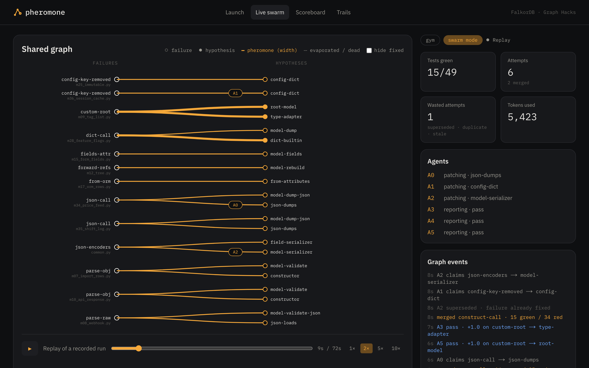
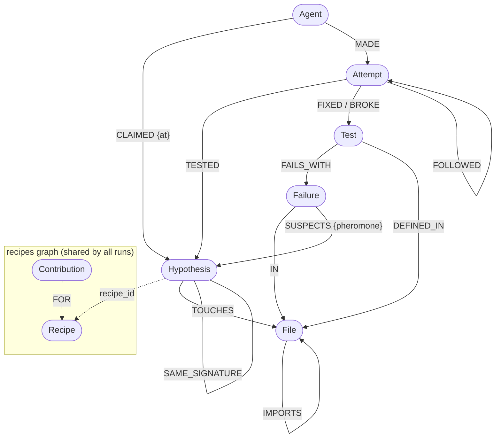
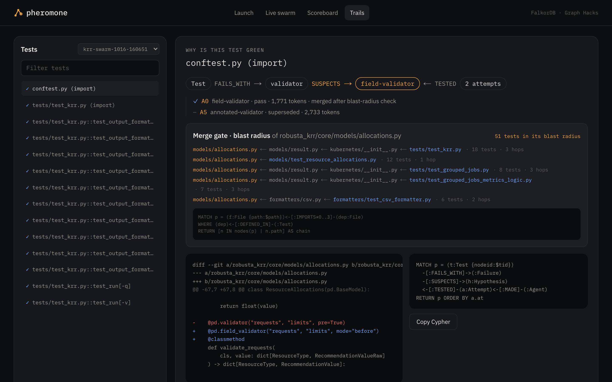
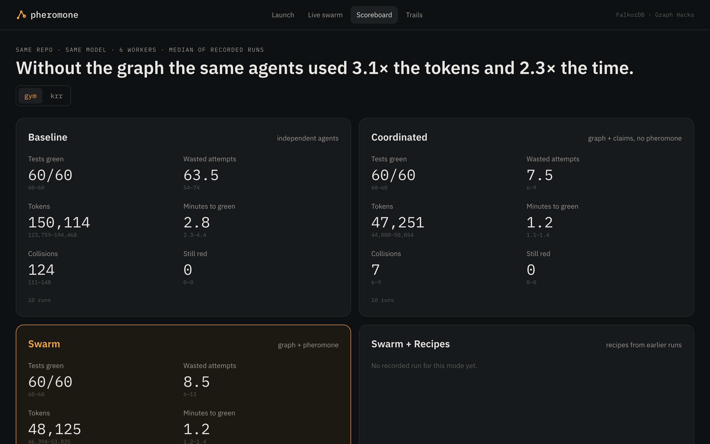
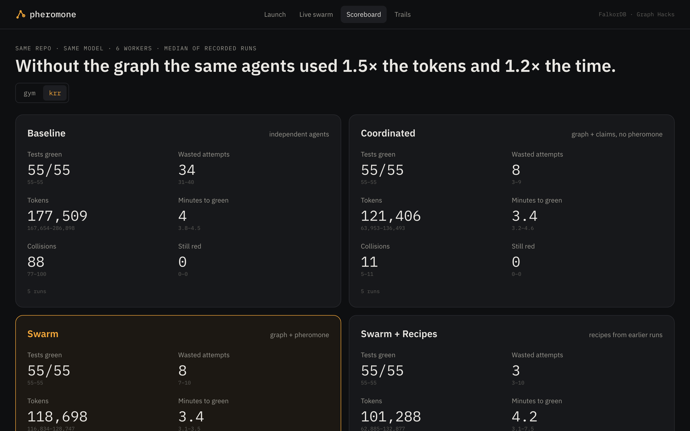
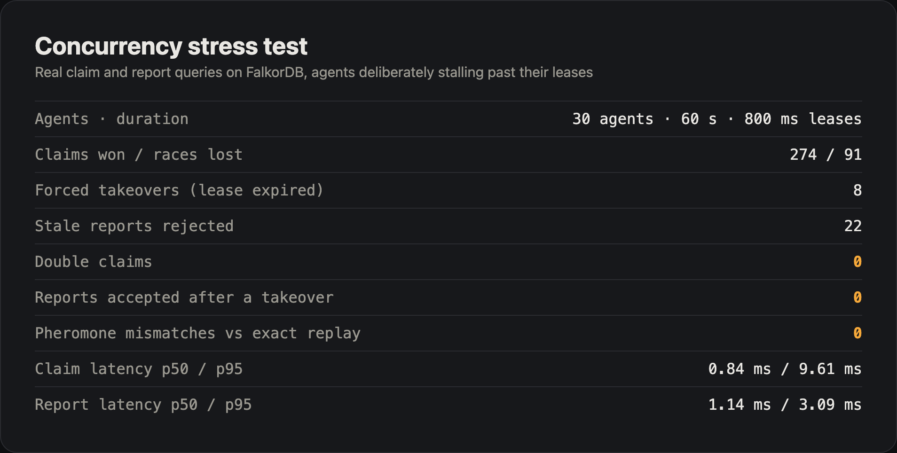

# Pheromone

**Six coding agents, zero messages, one FalkorDB graph.**

Pheromone is a swarm of identical coding agents that migrates Python code from Pydantic v1 to v2 with no orchestrator. The agents never talk to each other. They coordinate only by reading and writing a FalkorDB graph of failures, hypotheses, attempts and pheromone-weighted edges, the way ants coordinate through trails. Tests decide what gets reinforced, never the LLM. Fixes that keep winning crystallize into Recipes in a shared graph that outlives every run, and later runs start from them.

Built for WeMakeDevs **Graph Hacks** (FalkorDB). Tracks: **Track 02, Agent Memory and Coordination** and **Track 01, Agents That Act on Connected Data**.

> **Live dashboard** (replay of the 50 recorded runs): https://pheromone-sigma.vercel.app · **Demo video:** https://youtu.be/I_9wR4w37sg · **Blog post:** https://dev.to/karankartikeya/pheromone-coding-agents-works-together-like-ants-using-falkor-db-2gd4


<sub>A recorded gym run in the dashboard: thick amber edges are fixes the tests confirmed; each chip is an agent holding a claim.</sub>

---

## Why a graph

Independent coding agents working on the same red test suite need *some* coordination mechanism: without one they patch the same file at once, repeat each other's dead ends and redo fixes someone already made. Pheromone's coordination mechanism is shared, evidence-weighted state with no planner, and the state it coordinates on is a web of relations: failures, candidate fixes, attempts, agents, tests, files and the imports between them. A key-value store could hold the same state with enough extra indexes and scripts; in a graph those relations are represented directly, each coordination step is one atomic query, and the reasoning behind every decision can be inspected as a path.

- **Claims are a compare-and-set** on a Hypothesis node with a lease. No agent assigns work; an expired lease is how work is handed off, with the full attempt history attached.
- **Pheromone lives on edges.** `(:Failure)-[:SUSPECTS {pheromone}]->(:Hypothesis)` is changed only by deterministic test results and evaporates over time, so dead ends fade and fixes that work are chosen again.
- **Picking work is one read across relations:** pheromone on the edge, past attempts, agents holding same-signature fixes in other files, claimed sibling fixes, and fixes waiting to merge.
- **The graph knows the code.** `File-[:IMPORTS]->File` gives every patch a multi-hop blast radius (`IMPORTS*0..3`) of tests that must stay green before it merges. PageRank over imports weights central modules; WCC groups independent failures.
- **Memory outlives the run.** Repeated wins become Recipes in a separate `recipes` graph that a later run, on another repo, seeds hypotheses from.

**Baseline** is the comparison: the same agents, model, budget, hypothesis templates, prompts and merge gate, with every graph read removed. Each baseline agent learns the failures by running the test suite itself and keeps a private candidate list, so it has no shared claims, pheromone or attempt history. It answers "does this coordination system beat independent agents?". It does not isolate graph storage from shared state in general (see [Results](#results)).

## How a run works

1. **Bootstrap.** Check out the target at its last Pydantic v1 commit, run [`bump-pydantic`](https://github.com/pydantic/bump-pydantic), upgrade to v2. What the codemod leaves behind is the swarm's job.
2. **Seed.** Run the suite, group every red test into a Failure with a repo-agnostic signature (`validator-values`, `dict-call`, `json-encoders`, ...), link Tests, Files and imports, and attach 1-3 competing Hypotheses per Failure from hand-written templates.
3. **Swarm.** Every worker runs the same loop: read the frontier, pick by roulette on `τ^α · η^β / ((1+tries)(1+crowd)(1+w·siblings))`, claim with one atomic query, ask the LLM for SEARCH/REPLACE edits, run the target tests plus the blast radius, report. Only the reporter writes pheromone.
4. **Merge.** Passing patches are re-checked and merged one at a time onto a run branch; a full-suite rerun closes fixed Failures and opens the ones a fix reveals (fixing an import error usually uncovers the next layer).
5. **Propose.** When nothing is left to try for a Failure, any idle worker claims it and asks the LLM for two new hypotheses, validated before they enter the graph.
6. **Crystallize.** Winning (signature, fix kind) pairs become Recipes in the shared `recipes` graph.

## Graph model

Run graph `run:<id>` (one per run) and the shared `recipes` graph.



**Where the agents' decisions come from the graph.** No agent is told what to do; every choice is a query:

| Decision | Graph query | What it reads or writes |
| --- | --- | --- |
| Which fix to try next | `FRONTIER` | pheromone on `SUSPECTS`, earlier `Attempt`s, other agents' claims on the same failure and signature, fixes waiting to merge |
| Take the work without a collision | `CLAIM` | compare-and-set on `Hypothesis.status` with a lease; an expired lease is a handoff |
| What earlier agents already tried | `ATTEMPTS_ON` | every `Attempt` on this hypothesis, with its diff, so a new owner builds on the history |
| Is this diff a known dead end | `FAILED_DIFF` | `Attempt.diff_hash` across all agents |
| Which tests must stay green | `BLAST_RADIUS` | `(File)<-[:IMPORTS*0..3]-(File)<-[:DEFINED_IN]-(Test)` |
| What the swarm learns | `REPORT` | writes the `Attempt`, deposits pheromone, retires dead hypotheses (tests decide, never the LLM) |
| What carries to the next repo | `CRYSTALLIZE_CANDIDATES`, `UPSERT_RECIPE` | winning (signature, fix kind) pairs become `Recipe`s in the shared graph |

All of these are in [`docs/QUERIES.md`](docs/QUERIES.md). The Baseline mode removes every read above, which is how the [results](#results) measure what the graph contributes.

| Edge | Meaning |
| --- | --- |
| `(Test)-[:FAILS_WITH]->(Failure)` | a red test and the failure behind it |
| `(Test)-[:DEFINED_IN]->(File)`, `(Failure)-[:IN]->(File)` | where tests and failures live |
| `(File)-[:IMPORTS]->(File)` | static import graph (blast radius, PageRank) |
| `(Failure)-[:SUSPECTS {pheromone}]->(Hypothesis)` | a candidate fix and its trail strength |
| `(Hypothesis)-[:TOUCHES]->(File)`, `(Hypothesis)-[:SAME_SIGNATURE]-(Hypothesis)` | what a fix edits; crowding across files |
| `(Agent)-[:CLAIMED {at}]->(Hypothesis)` | claims, including handoffs after a lease expires |
| `(Agent)-[:MADE]->(Attempt)-[:TESTED]->(Hypothesis)` | episodic memory: every attempt with outcome, diff, tokens |
| `(Attempt)-[:FIXED\|BROKE]->(Test)`, `(Attempt)-[:FOLLOWED]->(Attempt)` | test effects; building on another agent's attempt |
| `(Contribution {run})-[:FOR]->(Recipe)` (recipes graph) | procedural memory, support counted per run |

## The Cypher that runs it

All queries live in [`backend/src/pheromone/graph/queries.py`](backend/src/pheromone/graph/queries.py); [`docs/QUERIES.md`](docs/QUERIES.md) is generated from it. The core ones:


<sub>Trails on a measured krr run: the test's path (Test → Failure → Hypothesis ← Attempt ← Agent), the merge gate's multi-hop blast radius, the merged diff and the Cypher behind it.</sub>

**Claim (compare-and-set).** An empty result means another agent won. An expired lease counts as open: that is the handoff.

```cypher
MATCH (h:Hypothesis {id:$hid}), (ag:Agent {id:$agent})
WHERE h.status = 'open' OR (h.status = 'claimed' AND h.lease_until < $now)
SET h.status = 'claimed', h.claimed_by = $agent, h.lease_until = $now + $lease_ms
CREATE (ag)-[:CLAIMED {at:$now}]->(h)
RETURN h.id AS id
```

**Report and deposit.** Guarded so an agent that lost its lease cannot overwrite the new owner; one deposit formula for pass and fail, clamped at τ_min; hypotheses retire after 3 failures.

```cypher
MATCH (h:Hypothesis {id:$hid}), (ag:Agent {id:$agent})
WHERE h.status = 'claimed' AND h.claimed_by = $agent
CREATE (ag)-[:MADE]->(a:Attempt {id:$aid, outcome:$outcome, diff_hash:$dh, diff:$diff,
        fixed:$fixed, broken:$broken, ms:$ms, tokens:$tok, at:$now, mode:$mode})-[:TESTED]->(h)
SET h.fails = coalesce(h.fails, 0) + CASE WHEN $outcome = 'pass' THEN 0 ELSE 1 END,
    h.claimed_by = null
SET h.status = CASE WHEN $outcome = 'pass' THEN 'fixed'
                    WHEN h.fails >= $max_fails THEN 'dead' ELSE 'open' END
WITH h, a
MATCH (h)<-[s:SUSPECTS]-(:Failure)
SET s.pheromone = CASE WHEN s.pheromone * $mult + $add < $tmin THEN $tmin
                       ELSE s.pheromone * $mult + $add END
RETURN a.id AS id, count(s) AS edges, h.status AS status
```

**Frontier**, **evaporation**, **lease release**, **blast radius** (`IMPORTS*0..3`), **crystallization**, **the trail behind a fix**, **PageRank** and **WCC** are in [`docs/QUERIES.md`](docs/QUERIES.md).

**One agent attempt, in queries** (counted from [`worker.py`](backend/src/pheromone/swarm/worker.py) and [`reporter.py`](backend/src/pheromone/swarm/reporter.py)):

| Step | Queries | What one query covers |
| --- | --- | --- |
| Choose work | 1 frontier read + 1 claim (+1 per lost race) | pheromone, attempts, crowding, claimed siblings, pending merges; compare-and-set with lease |
| Gather context | 4 reads | hypothesis and failure, prior attempts (the handoff history), failing tests, blast radius over `IMPORTS*0..3` |
| Duplicate check | 1 read | has this exact diff already failed anywhere |
| Report | 1 write + up to 3 link writes | Attempt node, Agent/Hypothesis edges, status, retirement and the pheromone deposit on every `SUSPECTS` edge, atomically, guarded against stale owners |

The context reads were one query until a FalkorDB crash forced a split (see Honest notes). Heartbeats for the dashboard add a few writes per attempt.

Two FalkorDB facts shaped every query: writes to a graph are serialized and each query is atomic, but there are no multi-query transactions, so every coordination step is one compare-and-set query; and `SET`/`CREATE` run on every matched row even if a `LIMIT` comes later, so no write relies on `LIMIT`.

## Targets

- **[`gym/`](gym/)**: a small Pydantic v1 codebase written for this project (38 modules, one test file each). Patterns come from the official migration guide, weighted toward what `bump-pydantic` leaves behind, plus ten v2 *behaviour* changes (union coercion, number-to-string coercion, float truncation, custom types, Decimal and UTC JSON output, ...). Its pytest config treats `DeprecationWarning` and `UserWarning` as errors: a migration counts as done only when no v1 API and no removed config key is left.
- **[robusta-dev/krr](https://github.com/robusta-dev/krr)** at the merge base of PR [#512](https://github.com/robusta-dev/krr/pull/512) (`c40fe37`). PR #512 is a human v2 migration that was **open, not merged**, when we picked it; we use it as a human reference, not as ground truth. krr runs with `-W error::pydantic.warnings.PydanticDeprecatedSince20`, the same definition of done.

## Run it locally

Requirements: Docker, [uv](https://docs.astral.sh/uv/), Node 20+ with pnpm, an OpenAI API key.

```bash
docker compose up -d                       # FalkorDB on localhost:6380, Browser on :3000
cd backend
echo "OPENAI_API_KEY=sk-..." > .env        # never committed
uv sync
uv run python -m pheromone.repo.bootstrap gym      # or: krr
uv run python -m pheromone.run --target gym --mode swarm --workers 6
uv run python -m pheromone.run --target gym --mode baseline --workers 6
uv run python -m pheromone.run --target krr --mode swarm+recipes --workers 6
```

Dashboard with live runs:

```bash
uv run uvicorn pheromone.api:app --port 8765          # in backend/
cd ../web && pnpm install && NEXT_PUBLIC_API_URL=http://localhost:8765 pnpm dev --port 3100
```

Useful flags: `--lease-s 20` (short leases make the kill-agent handoff visible), `--no-learn` (keep a control run out of the shared recipes graph), `--seed`, `--budget`, `--minutes`. Publish recorded runs to the static dashboard with `uv run python -m pheromone.publish <run_id> ...`. Tests: `uv run pytest` (needs FalkorDB running).

Model: one model for every agent in every mode (`LLM_MODEL`, default `gpt-6-luna`); it is recorded on every Run node.

## Results

**Measured batch** ([`bench/protocol_v2.py`](bench/protocol_v2.py), code frozen at tag [`measured-v2`](../../tree/measured-v2)): 50 runs, every one ending fully green (60/60 tests on the gym, 55/55 on krr, with Pydantic deprecation warnings treated as errors). Same target commits, model (`gpt-6-luna`), 6 workers, prompts, hypothesis templates and merge gate in every run; the token budget is a per-run cap of 2M that no run came close to. Run order was shuffled within each target. Phase 1 ran the gym 10 times per mode; its Swarm runs wrote the Recipes. Phase 2 ran krr 5 times per mode with `--no-learn`, so the Recipes it was evaluated with stayed frozen. The per-run log with commit, start/end time and exit code is [`runs/protocol_v2.csv`](runs/protocol_v2.csv); every run's graph is kept as `run:<id>` and can be [queried on FalkorDB Cloud](#query-the-real-graphs-yourself).

Four modes, from no coordination to full memory:

- **Baseline**: independent agents. Each learns the failures by running the tests itself and keeps a private list; no shared claims, history or pheromone.
- **Coordinated** (ablation): shared graph, claims, leases and attempt history, but pheromone never influences which hypothesis an agent picks.
- **Swarm**: Coordinated plus pheromone-weighted selection.
- **Swarm + Recipes**: Swarm plus hypotheses seeded from Recipes learned on the gym.

Medians, with min–max:

| Target | Mode | Tokens | Time to green | Collisions | Wasted attempts |
| --- | --- | --- | --- | --- | --- |
| gym (37 red tests at start) | Baseline | 150k (124k–194k) | 166 s (135–262) | 124 (111–148) | 64 (54–74) |
| gym | **Coordinated** | **47k** (44k–50k) | **72 s** (66–83) | **7** (6–9) | **7.5** (6–9) |
| gym | **Swarm** | **48k** (46k–54k) | **73 s** (70–85) | **8** (5–13) | **8.5** (6–13) |
| krr (one import error blocks all 55 tests) | Baseline | 178k (168k–287k) | 243 s (231–270) | 88 (77–100) | 34 (31–40) |
| krr | **Coordinated** | **121k** (64k–136k) | **207 s** (194–275) | **11** (5–11) | **8** (3–9) |
| krr | **Swarm** | **119k** (117k–129k) | **205 s** (186–211) | **13** (11–13) | **8** (7–10) |
| krr | Swarm + Recipes | 101k (63k–133k) | 253 s (187–450) | 5 (5–12) | 3 (3–10) |




<details>
<summary>All 50 runs</summary>

| Run | Target | Mode | Tests green | Tokens | Time to green | Attempts | Wasted | Collisions | Recipe share |
| --- | --- | --- | --- | --- | --- | --- | --- | --- | --- |
| `gym-baseline-1016-135331` | gym | baseline | 60/60 | 160,397 | 206 s | 101 | 62 | 111 | – |
| `gym-baseline-1016-135814` | gym | baseline | 60/60 | 151,459 | 194 s | 111 | 74 | 143 | – |
| `gym-baseline-1016-141323` | gym | baseline | 60/60 | 194,468 | 262 s | 110 | 70 | 127 | – |
| `gym-baseline-1016-141748` | gym | baseline | 60/60 | 136,101 | 154 s | 94 | 58 | 118 | – |
| `gym-baseline-1016-142026` | gym | baseline | 60/60 | 150,852 | 164 s | 104 | 67 | 121 | – |
| `gym-baseline-1016-142314` | gym | baseline | 60/60 | 123,759 | 135 s | 93 | 58 | 122 | – |
| `gym-baseline-1016-142642` | gym | baseline | 60/60 | 182,529 | 213 s | 114 | 74 | 148 | – |
| `gym-baseline-1016-143018` | gym | baseline | 60/60 | 128,961 | 149 s | 91 | 54 | 123 | – |
| `gym-baseline-1016-143359` | gym | baseline | 60/60 | 133,366 | 143 s | 97 | 62 | 144 | – |
| `gym-baseline-1016-144447` | gym | baseline | 60/60 | 149,375 | 168 s | 103 | 65 | 125 | – |
| `gym-coordinated-1016-135153` | gym | coordinated | 60/60 | 46,626 | 71 s | 42 | 7 | 7 | – |
| `gym-coordinated-1016-135700` | gym | coordinated | 60/60 | 48,135 | 71 s | 44 | 9 | 9 | – |
| `gym-coordinated-1016-140130` | gym | coordinated | 60/60 | 45,540 | 79 s | 43 | 8 | 8 | – |
| `gym-coordinated-1016-140924` | gym | coordinated | 60/60 | 49,463 | 83 s | 46 | 8 | 8 | – |
| `gym-coordinated-1016-141048` | gym | coordinated | 60/60 | 47,740 | 76 s | 45 | 9 | 8 | – |
| `gym-coordinated-1016-141206` | gym | coordinated | 60/60 | 50,054 | 75 s | 43 | 7 | 6 | – |
| `gym-coordinated-1016-143250` | gym | coordinated | 60/60 | 46,558 | 68 s | 42 | 7 | 6 | – |
| `gym-coordinated-1016-143737` | gym | coordinated | 60/60 | 46,762 | 68 s | 43 | 8 | 7 | – |
| `gym-coordinated-1016-144112` | gym | coordinated | 60/60 | 44,000 | 66 s | 41 | 6 | 6 | – |
| `gym-coordinated-1016-144219` | gym | coordinated | 60/60 | 48,758 | 72 s | 43 | 7 | 7 | – |
| `gym-swarm-1016-140251` | gym | swarm | 60/60 | 48,538 | 78 s | 46 | 11 | 11 | – |
| `gym-swarm-1016-140410` | gym | swarm | 60/60 | 52,783 | 76 s | 48 | 13 | 12 | – |
| `gym-swarm-1016-140528` | gym | swarm | 60/60 | 48,169 | 85 s | 43 | 6 | 6 | – |
| `gym-swarm-1016-140654` | gym | swarm | 60/60 | 48,081 | 76 s | 44 | 9 | 8 | – |
| `gym-swarm-1016-140810` | gym | swarm | 60/60 | 46,574 | 73 s | 41 | 6 | 5 | – |
| `gym-swarm-1016-142531` | gym | swarm | 60/60 | 51,045 | 70 s | 48 | 13 | 13 | – |
| `gym-swarm-1016-143624` | gym | swarm | 60/60 | 47,535 | 71 s | 44 | 7 | 7 | – |
| `gym-swarm-1016-143846` | gym | swarm | 60/60 | 47,398 | 70 s | 43 | 8 | 8 | – |
| `gym-swarm-1016-143957` | gym | swarm | 60/60 | 53,835 | 74 s | 48 | 11 | 11 | – |
| `gym-swarm-1016-144333` | gym | swarm | 60/60 | 46,394 | 72 s | 44 | 8 | 6 | – |
| `krr-baseline-1016-150219` | krr | baseline | 55/55 | 177,509 | 231 s | 41 | 31 | 83 | – |
| `krr-baseline-1016-150618` | krr | baseline | 55/55 | 286,898 | 270 s | 50 | 40 | 100 | – |
| `krr-baseline-1016-151532` | krr | baseline | 55/55 | 285,834 | 267 s | 49 | 39 | 100 | – |
| `krr-baseline-1016-154636` | krr | baseline | 55/55 | 167,654 | 243 s | 40 | 31 | 77 | – |
| `krr-baseline-1016-160251` | krr | baseline | 55/55 | 177,218 | 232 s | 43 | 34 | 88 | – |
| `krr-coordinated-1016-144737` | krr | coordinated | 55/55 | 136,493 | 212 s | 23 | 7 | 11 | – |
| `krr-coordinated-1016-151056` | krr | coordinated | 55/55 | 63,953 | 275 s | 13 | 3 | 5 | – |
| `krr-coordinated-1016-152346` | krr | coordinated | 55/55 | 121,406 | 195 s | 22 | 9 | 11 | – |
| `krr-coordinated-1016-153908` | krr | coordinated | 55/55 | 117,687 | 194 s | 22 | 9 | 11 | – |
| `krr-coordinated-1016-154255` | krr | coordinated | 55/55 | 130,453 | 207 s | 22 | 8 | 10 | – |
| `krr-swarm-1016-145849` | krr | swarm | 55/55 | 117,421 | 205 s | 22 | 7 | 13 | – |
| `krr-swarm-1016-153157` | krr | swarm | 55/55 | 118,698 | 186 s | 22 | 8 | 11 | – |
| `krr-swarm-1016-155047` | krr | swarm | 55/55 | 116,834 | 211 s | 23 | 8 | 13 | – |
| `krr-swarm-1016-155844` | krr | swarm | 55/55 | 128,747 | 205 s | 22 | 8 | 11 | – |
| `krr-swarm-1016-160651` | krr | swarm | 55/55 | 118,921 | 205 s | 23 | 10 | 13 | – |
| `krr-swarm-recipes-1016-145119` | krr | swarm+recipes | 55/55 | 118,743 | 450 s | 20 | 3 | 5 | 73% |
| `krr-swarm-recipes-1016-152006` | krr | swarm+recipes | 55/55 | 132,877 | 197 s | 22 | 9 | 10 | 89% |
| `krr-swarm-recipes-1016-152718` | krr | swarm+recipes | 55/55 | 78,716 | 279 s | 14 | 3 | 5 | 73% |
| `krr-swarm-recipes-1016-153547` | krr | swarm+recipes | 55/55 | 101,288 | 187 s | 23 | 10 | 12 | 89% |
| `krr-swarm-recipes-1016-155431` | krr | swarm+recipes | 55/55 | 62,885 | 253 s | 13 | 3 | 5 | 80% |

</details>

**What this shows:**

- **Shared state through the graph carries the result.** Against independent agents, the coordinated modes used 68–69% fewer tokens on the gym and 32–33% fewer on krr, reached green 56–57% faster on the gym and 15–16% faster on krr, and collided about ten times less often.
- **Pheromone-weighted selection added nothing measurable on these targets.** Coordinated and Swarm are within each other's range on every metric, on both repos. The gains come from shared claims, leases and attempt history, not from reinforcement. On failures this easy for the model (almost every attempt passes), there is little for pheromone to choose between; whether it helps on harder targets, where many attempts fail, is untested.
- **Recipes are inconclusive.** Recipe-seeded hypotheses produced 80% of the merged krr fixes (73–89%), and median tokens were 15% lower than Swarm, but the ranges overlap and one run was slow (450 s), so median time was worse. Five runs per mode can't settle it.
- **Limits.** Two targets, one of them written for this project; the gym served as the development benchmark (`sibling_weight` was tuned while watching gym runs), krr as the check on a repo we did not tune on. Tests decide what is "fixed", so a migration is only as verified as the target's tests.

**Concurrency.** [`bench/stress_claims.py`](bench/stress_claims.py) runs 30 agents for 60 s against the real claim and report queries, with 800 ms leases and agents that deliberately stall past them. Result ([`bench/results/stress_30x60.json`](bench/results/stress_30x60.json)): 274 claims won, 91 races lost, 8 forced takeovers, 22 stale reports rejected; **0 double claims, 0 reports accepted after a takeover, and 0 pheromone mismatches** against an exact replay of the accepted reports. Claim latency 0.8 ms median, 9.6 ms p95. At this load FalkorDB's default query queue (25) rejects the overflow ("Max pending queries exceeded", 526 times), which the agents absorb with jittered backoff; the 6-agent swarm never came close.



**First batch** (Thursday, 12 runs, [`bench/protocol.sh`](bench/protocol.sh)): Baseline vs Swarm only, 3 gym and 2 krr runs per mode, run on an earlier version of the code. It pointed the same way (gym tokens 176k → 50k, krr 231k → 94k) and is superseded by the batch above.

**Metric definitions** (computed by [`metrics.py`](backend/src/pheromone/metrics.py) from the event log and the attempts stored in each run graph):

- **Tokens**: all LLM input and output tokens in the run: patch generation, proposals, retries and failed patches.
- **Time to green**: seconds from seeding until the merge after which no test is red.
- **Collisions**: pairs of attempts by different agents on the same file whose time windows overlap.
- **Wasted attempts**: passing patches for a failure another agent had already fixed (superseded), plus attempts that repeated a diff or a hypothesis that had already failed.
- **Recipe share**: share of merged fixes whose hypothesis was seeded from a Recipe. It says where the winning hypothesis came from, not that the run needed it.

**Parameters.** α = 1, β = 2, τ0 = 0.5, τ_min = 0.05, evaporation ×0.95 every 10 s, lease 120 s, retirement after 3 failed or duplicate attempts, `sibling_weight` = 10. η = template prior (1, or 1 + ln(1 + support) for Recipe-seeded hypotheses) × (1 + PageRank of the file).

**krr vs the human migration.** In the measured swarm runs on krr the final diff touches 7 files; human PR #512 touches 8 (+33/−21). Similar file counts don't establish equal quality. Two concrete differences: the swarm runs also replaced a deprecated `result.json(indent=2)` in `formatters/json.py` that the PR left in place, and the PR changed a mutable default and an `__init__` override that no test exercises, which the swarm left alone.

## Query the real graphs yourself

All 50 measured run graphs and the shared `recipes` graph are on FalkorDB Cloud, with a read-only user. Read-only users must use `GRAPH.RO_QUERY`:

```bash
redis-cli -h r-6jissuruar.instance-9l47qt9zq.hc-7up0crkyn.ap-south-1.aws.f2e0a955bb84.cloud -p 55194 --user demo_user --pass demo123 \
  GRAPH.RO_QUERY "run:krr-swarm-1016-160651" \
  "MATCH (ag:Agent)-[:MADE]->(a:Attempt {merged:true})-[:TESTED]->(h:Hypothesis)<-[:SUSPECTS]-(f:Failure) RETURN f.signature, h.kind, ag.id ORDER BY a.at"
```

`GRAPH.LIST` shows every graph; the queries in [`docs/QUERIES.md`](docs/QUERIES.md) run as they are (the read-only ones). To ask in plain language instead, point an MCP client at the same instance: [`docs/MCP.md`](docs/MCP.md) has a read-only FalkorDB MCP setup and questions to try.

## Honest notes

- **Stigmergy for LLM agents is not new.** What we add is graph-native pheromone on FalkorDB over real code, test-verified reinforcement, a multi-hop merge gate, and procedural Recipes that carry across repos.
- **Tests decide, so tests can be fooled.** In an early run an agent made a frozen-model test pass by overriding `__eq__` and `__setattr__` instead of using `frozen=True`. We tightened the gym (removed config keys are now errors) and the prompts (no dunder overrides). Diffs are worth reading; the Trails screen shows every one.
- **krr's last tests are hard.** Its tests depend on run order and global config, and its CLI swallows exceptions into logs. Pheromone reads the logged traceback as the real cause and judges regressions against the same test selection before and after a patch.
- **FalkorDB crash.** One query shape (properties plus `collect()` on a hypothesis that was just claimed) crashed the server with a panic in `reply_compact`. We split it into plain-row queries.

## AI use (rule 11)

This project was built with an AI coding assistant (Claude Code), which wrote most of the code from a design and plan the author wrote and reviewed, ran the experiments and reported results. Every design decision, the target choice and every number in this README were reviewed by the author. At runtime, the swarm agents use an OpenAI model to propose patches and hypotheses; tests, not the model, decide what is kept.

## License

MIT
